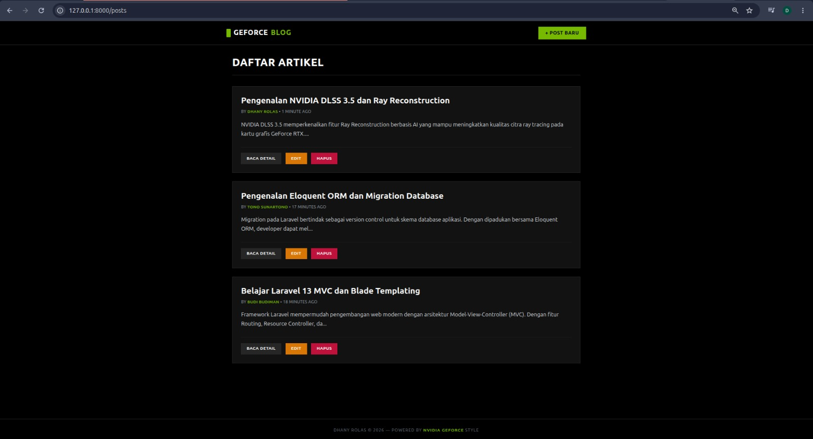
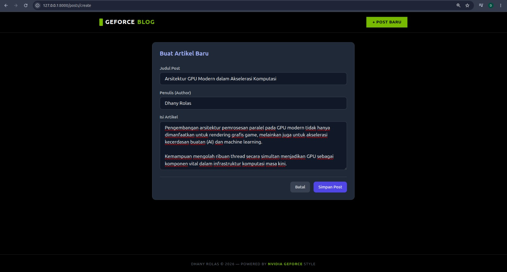

# Tugas Rutin 10 — Aplikasi Blog CRUD Laravel (GeForce Theme)

Repositori ini dibuat untuk memenuhi **Tugas Rutin 10 — Routing, Controller & Blade Templating** pada mata kuliah Pemrograman Web. Proyek ini mengimplementasikan aplikasi manajemen artikel blog berbasis *Full CRUD* menggunakan Laravel 13, Tailwind CSS CDN dengan tema kustom **NVIDIA GeForce**, serta arsitektur komponen Blade.

---

## 🚀 Fitur Utama & Kriteria Implementasi

1. **Resource Routing & Named Routes**: Menggunakan `Route::resource('posts', PostController::class)` untuk mengelola 7 tindakan standar HTTP (`index`, `create`, `store`, `show`, `edit`, `update`, `destroy`).
2. **Resource Controller**: `PostController` menangani logika bisnis CRUD, pengurutan artikel terbaru, dan pagination (`paginate(5)`).
3. **Blade Master Layout & Components**:
   - Master Layout `layouts/app.blade.php` bertema **NVIDIA GeForce** (hitam pekat, aksen hijau neon `#76b900`) sebagai kerangka utama halaman (`@extends`, `@yield`).
   - Component `<x-alert />` (`components/alert.blade.php`) untuk menyajikan notifikasi *flash message* dinamis.
4. **Form Security & Validation**:
   - Penggunaan direktif `@csrf` untuk perlindungan CSRF.
   - Method spoofing `@method('PUT')` dan `@method('DELETE')` pada form sunting & hapus.
   - Validasi input server-side dengan penanganan pesan kesalahan `@error` serta fungsi kustom `old()`.
5. **Route Model Binding**: Pemanfaatan `Post $post` untuk pencarian data otomatis berbasis Model Eloquent.

---

Dokumentasi dan Tangkapan Layar (Screenshot)

### 1. Halaman Utama (`/posts`)
Menampilkan daftar artikel blog yang telah diurutkan berdasarkan pembuatan terbaru (*latest*) dengan aksen warna hijau neon `#76b900` dan tombol navigasi CRUD yang responsif.


### 2. Form Tambah Artikel (`/posts/create`)
Antarmuka formulir input untuk menambahkan postingan artikel baru lengkap dengan validasi *server-side* dan proteksi CSRF `@csrf`.


### 3. Detail Artikel & Notifikasi Flash Message (`/posts/{id}`)
Tampilan detail baca artikel yang dilengkapi komponen notifikasi dinamis (`<x-alert />`) di bagian atas sebagai indikator keberhasilan pembaruan data.


### 4. Verifikasi Basis Data MySQL
Hasil pengujian manipulasi data CRUD yang terverifikasi secara langsung pada tabel `posts` di dalam basis data `blog_crud_db` melalui *terminal MySQL CLI*.


## 🛠️ Prasyarat & Instalasi Lokal

### 1. Prasyarat Sistem
- **PHP**: Versi >= 8.2
- **Composer**: Versi 2.x
- **MySQL / MariaDB Server**

### 2. Langkah Menjalankan Proyek

1. **Cloning Repositori**:
   ```bash
   git clone [https://github.com/dhanyrolas21/TugasWeb-P10-BlogCRUD.git](https://github.com/dhanyrolas21/TugasWeb-P10-BlogCRUD.git)
   cd TugasWeb-P10-BlogCRUD

   .
## 📁 Struktur Direktori Proyek

```text
.
├── app/
│   ├── Http/
│   │   └── Controllers/
│   │       └── PostController.php    # Resource Controller pengelola logika CRUD Blog
│   └── Models/
│       └── Post.php                  # Model Eloquent Post ($fillable)
├── database/
│   └── migrations/
│       └── xxxx_xx_xx_xxxxxx_create_posts_table.php # Skema tabel posts
├── resources/
│   └── views/
│       ├── components/
│       │   └── alert.blade.php       # Blade component untuk notifikasi flash message
│       ├── layouts/
│       │   └── app.blade.php         # Master layout bertema NVIDIA GeForce
│       └── posts/
│           ├── create.blade.php      # Form tambah artikel baru
│           ├── edit.blade.php        # Form edit artikel
│           ├── index.blade.php       # Halaman daftar artikel
│           └── show.blade.php        # Halaman detail baca artikel
├── routes/
│   └── web.php                       # Definisi Route::resource('posts')
└── README.md                         # Dokumentasi utama proyek
```

Dhany Rolas
Tugas Mata Kuliah PemrogramanWeb-P10-BlogCRUD. 
Universitas Negeri Medan
